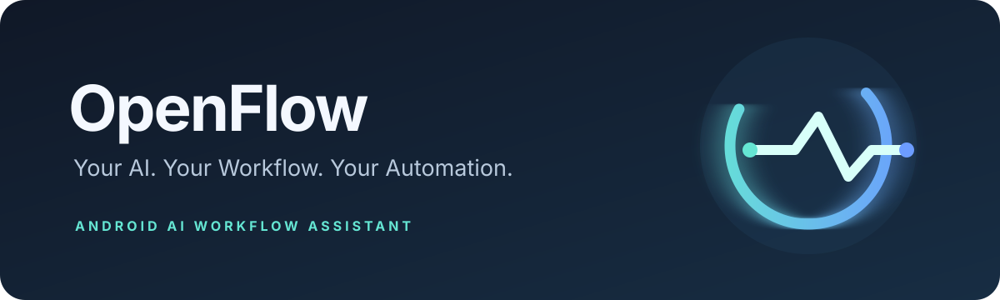

# OpenFlow

<p align="center">
  
</p>

<p align="center">
  <strong>Your AI. Your Workflow. Your Automation.</strong>
  <br />A user-controlled Android companion for long-running AI conversations.
</p>

<p align="center">
  
  
  
  
</p>

---

## What is OpenFlow?

**OpenFlow** is an Android assistant designed to make long-running conversations with AI apps easier to manage. It combines a floating companion, context-handoff tools and conservative automation safeguards.

The first test device is a **Redmi Note 13 4G running Android 15**.

## What's in the current prototype?

| Feature | State |
|---|---|
| Dark OpenFlow dashboard | Implemented |
| Settings and permission guidance | Implemented |
| Movable floating companion overlay | Implemented |
| Pause, resume and stop controls | Implemented |
| Ongoing Android foreground notification | Implemented |
| Context-handoff request and clipboard workspace | Implemented |
| Conservative safety policy + bilingual unit tests | Implemented |
| Opt-in ChatGPT accessibility observer | Implemented; device testing required |
| Response-completion and safety-state detection | Implemented heuristically |
| Opt-in auto-continue after a stable response | Implemented; device testing required |
| Long-chat detection | Approximate; counts distinct visible text fingerprints across bounded scroll scan |
| One-shot automatic summary request | Optional explicit opt-in; waits for response and pauses for review |
| Automatic new-chat handoff | Manual review, clipboard copy and app launch; new-chat selection/injection still manual |
| ChatGPT reasoning-mode selection | Not controllable reliably by an external app; select manually |
| AI provider/API integration | Not implemented |

When you explicitly enable the ChatGPT accessibility service in Android Settings, OpenFlow observes the active ChatGPT app accessibility tree locally. It does not capture screenshots or upload conversation text. Auto-continue is a separate opt-in switch and sends a saved continuation prompt only after a stable completion signal. Long-chat detection is heuristic and counts distinct text-block fingerprints across the scroll scan. If you separately enable automatic summary requests, OpenFlow sends one structured request at the threshold, waits for a detected generation cycle and then pauses for manual review. It does not copy the assistant's summary text, create a new chat or inject the handoff automatically; those steps remain manual until the ChatGPT Android selectors can be verified on the target device.

## First run

1. Install the debug APK from the **OpenFlow-debug-apk** artifact in the latest successful GitHub Actions run.
2. Open OpenFlow and tap **Launch floating assistant**.
3. Grant **Display over other apps** when Android asks.
4. Grant notification permission when prompted, then tap Launch again.
5. Use the floating panel to pause, resume or stop it. Pause/stop also disables ChatGPT monitoring; resume the monitor separately from Settings. You can also stop the panel from the ongoing notification.

Android or the device manufacturer may restrict overlays and foreground services based on system settings and battery management.

## Build from source

Requirements: JDK 17, Android SDK Platform 36 and Gradle 8.13.

```bash
gradle --no-daemon testDebugUnitTest
gradle --no-daemon assembleDebug
```

APK output: `app/build/outputs/apk/debug/app-debug.apk`.

GitHub Actions runs unit tests and builds a debug APK on pushes to `main`, pull requests and manual workflow dispatches. The APK is uploaded as a workflow artifact.

## Design principles

1. **User control first.** Keep active automation visible and provide immediate pause and stop controls.
2. **Fail closed.** Limits, errors, access restrictions, CAPTCHA challenges and unknown states must stop automation.
3. **No limit evasion.** Never rotate accounts, reset quotas, bypass CAPTCHAs or defeat service restrictions.
4. **Privacy by default.** Accessibility inspection stays on-device; no screenshots or conversation uploads.
5. **Explicit opt-in.** Auto-continue and automatic summary requests are off until separately enabled by the user.
6. **Honest feature states.** Heuristic detection and unfinished handoff features are clearly labelled.

## Roadmap and privacy

See [docs/ROADMAP.md](docs/ROADMAP.md), [docs/PRIVACY.md](docs/PRIVACY.md) and [CONTRIBUTING.md](CONTRIBUTING.md).

## License

OpenFlow is released under the [MIT License](LICENSE).
